<picture>
  <source media="(prefers-color-scheme: dark)" srcset="assets/banner-dark.svg">
  <source media="(prefers-color-scheme: light)" srcset="assets/banner-light.svg">
  
</picture>

  
  
  
  

Hago apps web en tiempo real y apps Android. Mi app **Luna** tiene 5.0★ en Google Play.

 

 

### Proyectos

| | | |
| :-- | :-- | :-- |
| 📱 | [**Luna**](https://play.google.com/store/apps/details?id=com.luna.ciclokawaii) | App de ciclo menstrual, offline y sin cuentas · 5.0★ |
| 🎟️ | **Muchik Eventos** | Control de acceso con QR en tiempo real · Supabase |
| 🧠 | **Psychology Platform** | Citas y chat con psicólogos · React |
| 📚 | **Repositorio Docente** | Biblioteca de PDFs con filtro instantáneo · React |
| 🏮 | [**Hanko**](https://nicolasquev.github.io/Hanko/) | Tracker de anime estilo catálogo impreso · Next.js |
| 🤖 | **Discord Bot** | Juegos y cumpleaños automáticos · Python |

 

Beta tester premiado de Google Flow · Google WebDev Insights · IBM · Cisco · [Microsoft AI Skills Fest](https://www.credly.com/badges/f3eff294-7612-4441-82be-50751f2afb53/public_url)
