<picture>
  <source media="(prefers-color-scheme: dark)" srcset="assets/banner-dark.svg">
  <source media="(prefers-color-scheme: light)" srcset="assets/banner-light.svg">
  
</picture>

  
  
  

  
  
  
  
   
  

<picture>
  <source media="(prefers-color-scheme: dark)" srcset="assets/h-sobre-mi-dark.svg">
  <source media="(prefers-color-scheme: light)" srcset="assets/h-sobre-mi-light.svg">
  
</picture>

- 📱 Publiqué **[Luna](https://play.google.com/store/apps/details?id=com.luna.ciclokawaii)** en Google Play: una app de ciclo menstrual offline, sin cuentas, con **5.0 ★**.
- ⚡ Hago web rápida con **React, Next.js y Vite**, y apps en tiempo real con **Supabase + PostgreSQL**.
- 🔍 Beta tester premiado en **Google Flow** y miembro de **Google WebDev Insights (C Space)**.
- 🐳 Automatizo con **Python** y despliego con **Docker y Kubernetes**.

  <picture>
    <source media="(prefers-color-scheme: dark)" srcset="assets/soft-skills-dark.svg">
    <source media="(prefers-color-scheme: light)" srcset="assets/soft-skills-light.svg">
    
  </picture>
  <picture>
    <source media="(prefers-color-scheme: dark)" srcset="assets/numbers-dark.svg">
    <source media="(prefers-color-scheme: light)" srcset="assets/numbers-light.svg">
    
  </picture>

<picture>
  <source media="(prefers-color-scheme: dark)" srcset="assets/h-stack-dark.svg">
  <source media="(prefers-color-scheme: light)" srcset="assets/h-stack-light.svg">
  
</picture>

<picture>
  <source media="(prefers-color-scheme: dark)" srcset="assets/stack-dark.svg">
  <source media="(prefers-color-scheme: light)" srcset="assets/stack-light.svg">
  
</picture>

<table align="center">
  <tr>
    <td align="center" width="25%"><b>Frontend</b>  </td>
    <td align="center" width="25%"><b>Backend y datos</b>  </td>
    <td align="center" width="25%"><b>Móvil</b>  </td>
    <td align="center" width="25%"><b>DevOps</b>  </td>
  </tr>
</table>

<picture>
  <source media="(prefers-color-scheme: dark)" srcset="assets/h-proyectos-dark.svg">
  <source media="(prefers-color-scheme: light)" srcset="assets/h-proyectos-light.svg">
  
</picture>

<table>
  <tr>
    <td width="50%" valign="top">
      <h4>📱 <a href="https://play.google.com/store/apps/details?id=com.luna.ciclokawaii">Luna</a></h4>
      
      
      
App Android para seguir tu ciclo. Tus datos se quedan en tu teléfono.

      <code>Android</code> <code>UI/UX</code> <code>Privacidad</code>
    </td>
    <td width="50%" valign="top">
      <h4>🎟️ Muchik Eventos</h4>
      
      
Control de acceso a eventos: escaneas el QR y la entrada se valida al instante.

      <code>Vanilla JS</code> <code>Vite</code> <code>Supabase Realtime</code> <code>jsPDF</code>
    </td>
  </tr>
  <tr>
    <td width="50%" valign="top">
      <h4>🧠 Psychology Platform</h4>
      
      
Muro social, perfiles de psicólogos, citas y chat en tiempo real.

      <code>React</code> <code>Tailwind</code> <code>Node.js</code>
    </td>
    <td width="50%" valign="top">
      <h4>📚 Repositorio Docente</h4>
      
      
Biblioteca de revistas y PDFs de Derecho Penal para un docente universitario.

      <code>React</code> <code>Vite</code> <code>Intersection Observer</code>
    </td>
  </tr>
  <tr>
    <td width="50%" valign="top">
      <h4>🏮 <a href="https://nicolasquev.github.io/Hanko/">Hanko</a></h4>
      
      
Tracker de anime con estética de catálogo impreso. Todo se guarda en tu navegador.

      <code>Next.js</code> <code>TypeScript</code> <code>GSAP</code>
    </td>
    <td width="50%" valign="top">
      <h4>🤖 Discord Bot</h4>
      
      
Galleta de la fortuna, cumpleaños automáticos y datos guardados en la nube.

      <code>Python</code> <code>discord.py</code> <code>Supabase</code>
    </td>
  </tr>
</table>

<picture>
  <source media="(prefers-color-scheme: dark)" srcset="assets/h-actividad-dark.svg">
  <source media="(prefers-color-scheme: light)" srcset="assets/h-actividad-light.svg">
  
</picture>

  <picture>
    <source media="(prefers-color-scheme: dark)" srcset="https://streak-stats.demolab.com?user=NicolasQuev&hide_border=true&background=0D1117&stroke=21262D&ring=38BDF8&fire=F472B6&currStreakNum=F0F6FC&sideNums=F0F6FC&currStreakLabel=38BDF8&sideLabels=8B949E&dates=6E7681&locale=es">
    
  </picture>

<picture>
  <source media="(prefers-color-scheme: dark)" srcset="assets/h-certificaciones-dark.svg">
  <source media="(prefers-color-scheme: light)" srcset="assets/h-certificaciones-light.svg">
  
</picture>

| | |
| :-- | :-- |
|  | Beta tester premiado de Flow App · Google WebDev Insights (C Space) |
|  | AI Skills Fest 2026 · [ver en Credly](https://www.credly.com/badges/f3eff294-7612-4441-82be-50751f2afb53/public_url) |
|  | Python for Data Science · Fundamentos de IA · Containers, Kubernetes & OpenShift |
|  | Intro to Data Science · Intro to Modern AI · Intro to Cybersecurity |

<picture>
  <source media="(prefers-color-scheme: dark)" srcset="assets/h-contacto-dark.svg">
  <source media="(prefers-color-scheme: light)" srcset="assets/h-contacto-light.svg">
  
</picture>

  &nbsp;&nbsp;&nbsp;
  &nbsp;&nbsp;&nbsp;
  &nbsp;&nbsp;&nbsp;
  &nbsp;&nbsp;&nbsp;
  

<i>"El código es arte en constante evolución."</i> ✨

<picture>
  <source media="(prefers-color-scheme: dark)" srcset="assets/footer-dark.svg">
  <source media="(prefers-color-scheme: light)" srcset="assets/footer-light.svg">
  
</picture>
